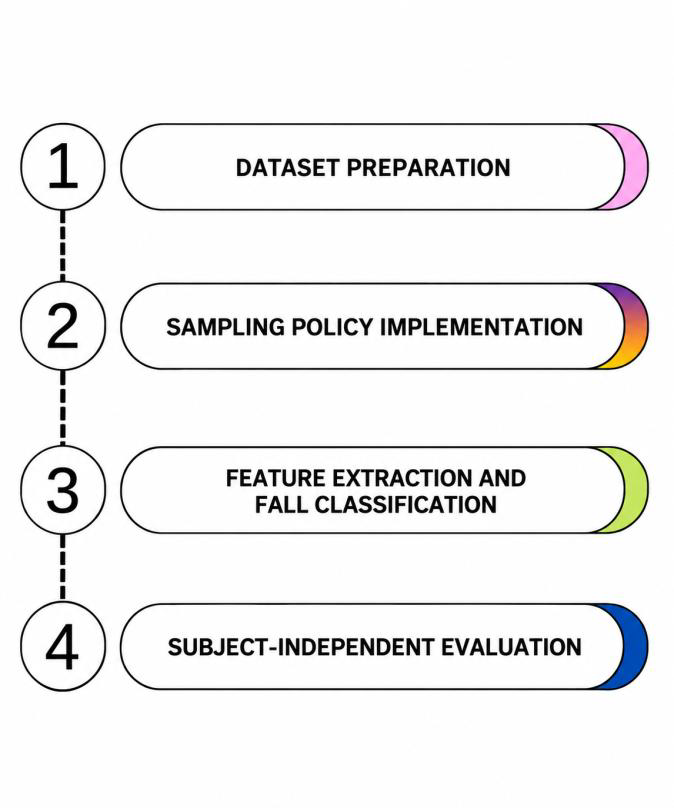
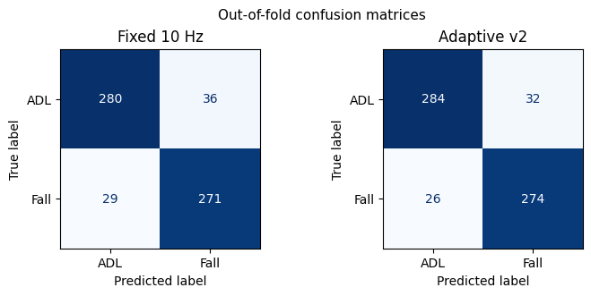
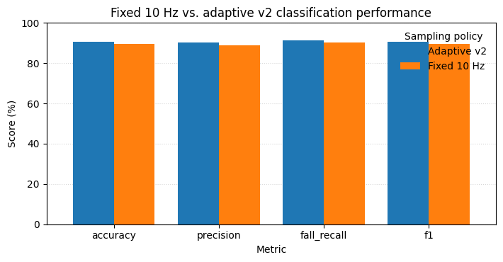
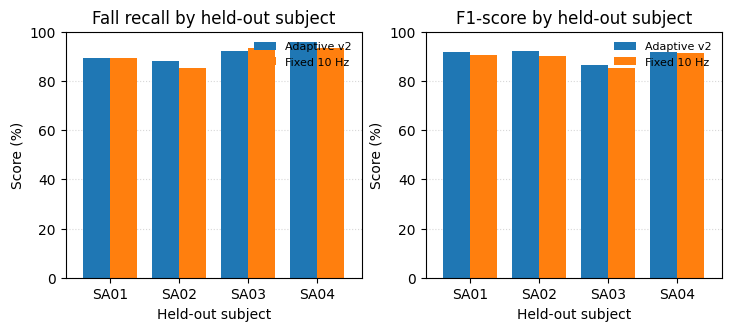
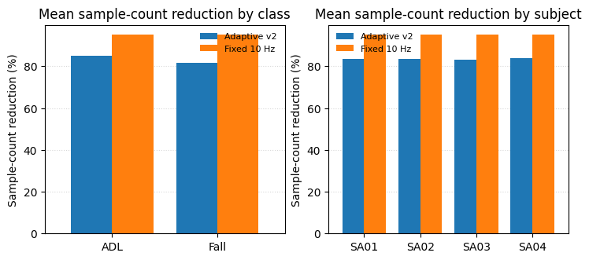
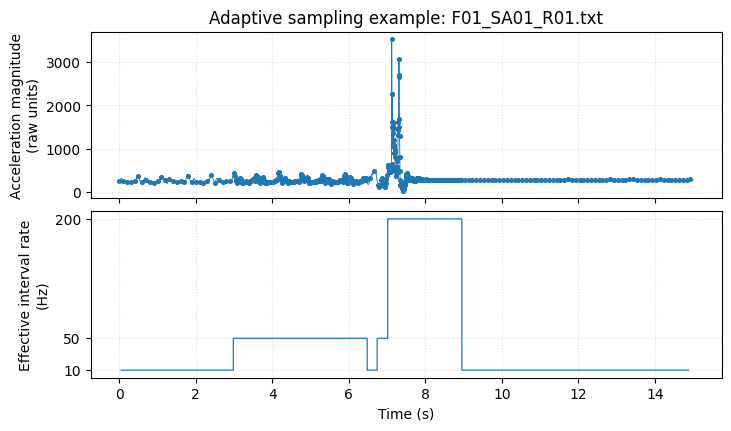

# Dynamic Sampling Rate Adaptation for Energy-Efficient Wearable Fall Monitoring

## 1. Project Overview

Wearable fall detection systems are important for monitoring elderly people and individuals who may require emergency assistance.

Traditional wearable systems continuously collect sensor data at a fixed sampling rate. This can lead to unnecessary data acquisition and increased energy consumption, even when the user is performing low-intensity activities.

This project proposes a **Dynamic Sampling Rate Adaptation** approach that adjusts the sensor sampling frequency according to detected movement intensity.

The objective is to reduce unnecessary sampling while maintaining reliable fall-detection performance.

## 2. Project Objectives

- Develop a wearable fall-monitoring approach using inertial sensor data.
- Detect variations in body movement using accelerometer signals.
- Dynamically adapt the sampling rate based on movement intensity.
- Implement a machine-learning model for fall detection.
- Compare adaptive sampling with conventional fixed-rate sampling.
- Evaluate detection performance and potential energy savings.

## 3. System Architecture



### System Workflow

1. Collect or load accelerometer sensor data.
2. Preprocess the sensor measurements.
3. Calculate acceleration magnitude.
4. Detect movement variations.
5. Select an appropriate sampling rate.
6. Extract features from the sensor data.
7. Perform fall classification.
8. Evaluate performance and sampling efficiency.

## 4. Dataset Description

**Dataset:** SisFall

The SisFall dataset contains inertial sensor recordings of falls and Activities of Daily Living (ADL).

### Sensor Information

| Sensor | Measurements |
|---|---|
| Accelerometer | X, Y and Z axes |
| Gyroscope | X, Y and Z axes |
| Second accelerometer | X, Y and Z axes |

### Dataset Categories

- Fall activities
- Activities of Daily Living (ADL)

**Dataset source:** [Add the official dataset source link]

**Dataset location:** Not included in this public repository. Follow the dataset download instructions before running the notebook.

## 5. Technologies Used

| Category | Technology |
|---|---|
| Programming Language | Python |
| Development Environment | Google Colab |
| Dataset | SisFall |
| Data Processing | NumPy, Pandas |
| Visualization | Matplotlib |
| Machine Learning | [Confirm actual model and framework] |
| Version Control | Git and GitHub |

## 6. Proposed Methodology

### 6.1 Data Preprocessing
Describe how sensor recordings are loaded, cleaned, segmented and prepared.

### 6.2 Motion Variation Detection
Explain how acceleration magnitude and variation are calculated to identify changes in movement intensity.

### 6.3 Adaptive Sampling Rate
Explain how the sampling controller selects different sampling frequencies according to the detected movement variation.

### 6.4 Fall Detection
Describe the machine-learning model, input features or signal windows, training procedure and prediction classes.

### 6.5 Performance Evaluation
Compare the adaptive sampling approach with fixed-rate sampling using detection metrics and sample reduction.

## 7. Implementation

**Main Google Colab Notebook:**

[text](ieee_conference_paper.ipynb)


Include the following implementation modules when available:

- Data loading and preprocessing
- Acceleration magnitude calculation
- Variation detection
- Adaptive sampling controller
- Feature extraction
- Model training and prediction
- Performance evaluation

## 8. Experimental Results











### 8.5 Performance Comparison

| Metric | Fixed Sampling | Adaptive Sampling |
|---|---|---|
| Accuracy | To be updated | To be updated |
| Precision | To be updated | To be updated |
| Recall | To be updated | To be updated |
| F1-score | To be updated | To be updated |
| Sample Reduction | Baseline | To be updated |
| Energy Consumption | To be updated | To be updated |

*Replace all placeholders with verified experimental results.*

## 9. Project Structure

```text
Dynamic-Sampling-Fall-Monitoring/
│
├── notebooks/
│   └── main_implementation.ipynb
│
├── src/
│   ├── preprocessing.py
│   ├── variation_detection.py
│   ├── adaptive_sampling.py
│   └── fall_detection.py
│
├── dataset/
│   └── README.md
│
├── diagrams/
│   └── system_architecture.png
│
├── results/
│   ├── sensor_signals.png
│   ├── adaptive_sampling.png
│   ├── classification_results.png
│   └── confusion_matrix.png
│
├── docs/
│   └── project_documentation.pdf
│
├── requirements.txt
├── .gitignore
└── README.md
```


## 10. Expected Outcomes

- Movement-aware sampling-rate selection.
- Reduced unnecessary sensor sampling.
- Reliable fall-versus-normal activity classification.
- Quantitative comparison with fixed-rate sampling.
- Evaluation of potential energy-efficiency improvements.

## 11. Team Details

**Project Title:** Dynamic Sampling Rate Adaptation for Energy-Efficient Wearable Fall Monitoring

**Team Number:** [Enter team number]

**Team Members:**
- [Member 1 – Register Number]
- [Member 2 – Register Number]
- [Add other members]

**Project Mentor:** [Mentor name]

**Department:** Computer Science and Engineering

**Institution:** Saveetha Engineering College, Chennai

## 12. References

1. SisFall dataset research paper and official dataset documentation.
2. Research papers related to wearable fall detection.
3. Research papers related to adaptive sampling and energy-efficient sensor systems.
4. Documentation of the Python libraries and machine-learning framework used.

[Add complete references and publication details here.]